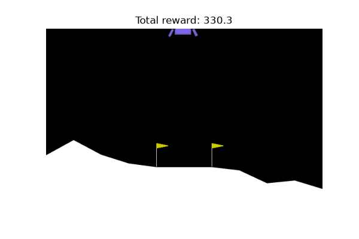

# LunarLander-v3 × Deep Q-Network

用 DQN 讓 Gymnasium 的登月小艇（LunarLander-v3）平穩著陸。
程式改寫自《Deep Reinforcement Learning in Action》第 3 章的 DQN 範例（Listing 3.7：經驗回放 + 目標網路），原本的環境是 Gridworld。

<p align="center"><br>訓練後的最佳單局：330.3 分</p>

## 成果

| 指標 | 結果 |
|---|---|
| 100 局測試平均分數 | **235.1**（門檻 200） |
| 成功降落率（單局 ≥ 200 分） | **90%** |
| 5 次獨立訓練的測試平均 | **238.4 ± 11.3**，5 次全部 ≥ 200 |
| 最終 loss（最後 1000 次更新 MSE 平均） | 18.9 |

| # | 訓練來源 | 測試平均 | 成功率 |
|---|---|---|---|
| 1 | `LunarLander_DQN.ipynb` | 235.1 | 90% |
| 2 | `dqn_lunarlander.py --seed 0` | 227.9 | 84% |
| 3 | `dqn_lunarlander.py --seed 1` | 228.5 | 85% |
| 4 | `dqn_lunarlander.py --seed 2` | 251.5 | 90% |
| 5 | `dqn_lunarlander.py --seed 3` | 249.2 | 92% |

## 檔案

| 檔案 | 內容 |
|---|---|
| `LunarLander_DQN.ipynb` | 主程式（含執行結果與中文註解） |
| `dqn_lunarlander.py` | 同一份演算法與超參數的腳本版，可用 `--seed` 固定隨機種子 |
| `logs/` | 4 次腳本訓練的紀錄（seed 0–3） |
| `figures/` | 分數曲線、loss、測試分數直方圖、ε 曲線、訓練前後 GIF |

## 相對第 3 章的主要修改

1. **環境**：Gridworld → `gymnasium.make("LunarLander-v3")`；狀態是 8 個連續數值，不需 `reshape(1, 64)` 與雜訊。
2. **網路與超參數**：輸入 64 → 8；學習率 1e-3 → 5e-4；γ 0.9 → 0.99；ε 由 1.0 每局 ×0.995 遞減（下限 0.01）。
3. **經驗回放與目標網路**：記憶體 1,000 → 100,000；批次 200 → 64；同步 500 → 1,000 步；每 4 步訓練一次；先收集 1,000 筆再開始訓練。
4. **終止訊號**：只把 `terminated` 存進記憶體，超時的 `truncated` 不把未來價值歸零（與課本 `max_moves` 的處理方式相同）。
5. **梯度裁剪**：`clip_grad_norm_(..., 10.0)`。
6. **評估**：`test_model` 回傳整局總分，以 100 局平均分數與成功率評估。

## 執行

```bash
pip install -r requirements.txt
python dqn_lunarlander.py --seed 0        # 訓練 600 局 + 測試 100 局
python dqn_lunarlander.py --render        # 觀看訓練好的模型
```

Notebook 版本請用 Jupyter 依序執行 `LunarLander_DQN.ipynb`。

## 來源與授權

- 原始程式：[DeepReinforcementLearning/DeepReinforcementLearningInAction](https://github.com/DeepReinforcementLearning/DeepReinforcementLearningInAction)（MIT License）
- 書籍：Alexander Zai, Brandon Brown,《Deep Reinforcement Learning in Action》, Manning, 2020
- 本專案沿用 MIT License，見 `LICENSE`
